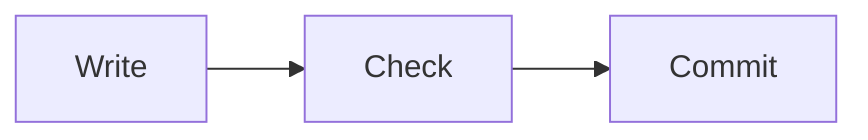

This page is temporary. It holds one of each kind of content the book uses, so the themes can be checked before the chapters move.

## Level 2 heading

A paragraph with a link to the [Starlight documentation](https://starlight.astro.build/) and some `inline code`.

### Level 3 heading

A code block with a file name comment on its first line:

```python
# tests/test_sample.py
def test_sample():
    assert 1 + 1 == 2
```

An output block. This one is illustrative, not from a real run:

```text
sample output line 1
sample output line 2
```

A table:

| Item | Today | After the move |
| --- | --- | --- |
| Site generator | MkDocs Material | Astro Starlight |
| Diagrams | Mermaid | Mermaid |

An aside:

:::note[Title]
The text of a note aside.
:::

A diagram:


